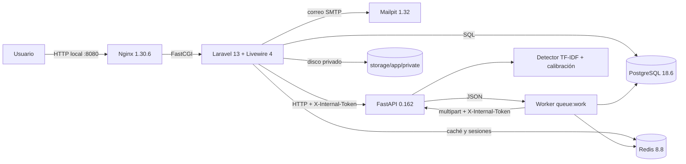
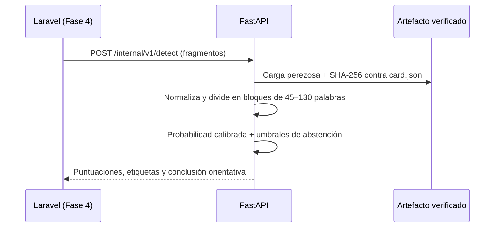
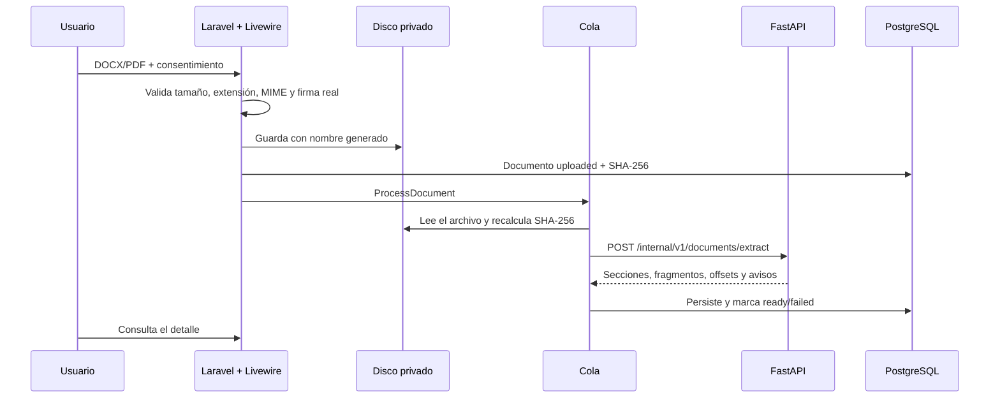

# Arquitectura

## Objetivo

SciTrace AI separa la aplicación web (experiencia de usuario, autenticación, permisos, persistencia y auditoría) del motor de análisis (extracción, OCR y clasificación calibrada). La separación permite evolucionar el detector sin reescribir la aplicación y aislar el consumo intensivo de CPU/memoria.

La Fase 3 añade un detector real entrenado, calibrado y versionado. El motor carga el artefacto desde `AI_MODEL_DIR`, verifica su SHA-256 contra `card.json` y solo entonces declara `detector_ready=true` y la capacidad `ai_detection` en `available`. Si el artefacto falta o no coincide, el endpoint de detección responde `503`.

## Principios

- **Monolito modular + microservicio de análisis.** Laravel concentra el dominio web; FastAPI concentra el procesamiento pesado.
- **Todo open source.** Sin APIs de detección comerciales.
- **Privado por defecto.** Documentos e informes fuera de `public/`.
- **Resultado orientativo.** El detector devuelve señales y un nivel de confianza; nunca una prueba de autoría.
- **Inconcluso es un resultado válido.** El esquema contempla `not_conclusive` e `insufficient`.
- **Trazabilidad.** Auditoría de acciones sensibles y `X-Request-ID` entre servicios.
- **Verificación antes de avanzar.** Cada fase tiene criterios de aceptación explícitos.

## Diagrama de componentes

## Flujo de detección

1. El artefacto se monta en solo lectura en `/app/models`.
2. La primera petición carga el modelo y verifica su integridad; las siguientes usan caché.
3. Cada fragmento se normaliza con la misma función usada en el entrenamiento.
4. Si la probabilidad cae entre los umbrales, la etiqueta es `uncertain` y exige revisión humana.
5. La conclusión del documento es `not_conclusive`, `no_signals`, `review_suggested` o `mixed_signals`.
6. Nunca se devuelve un porcentaje de texto generado por IA.

## Responsabilidades

| Componente | Responsabilidad en Fase 3 | No hace todavía |
| --- | --- | --- |
| Nginx | Terminación HTTP, archivos estáticos, encabezados de seguridad, proxy FastCGI | TLS público |
| Laravel | Autenticación, roles, perfil, administración, auditoría, salud, carga privada, permisos documentales y cliente del motor | Orquestar el análisis y emitir juicios de autoría |
| Livewire | Componentes reactivos para autenticación, administración, carga, listado y detalle de documentos | Interfaz de revisión de resultados |
| Worker | Cola de trabajos; ejecuta `ProcessDocument` y verifica integridad | Análisis o inferencia |
| FastAPI | Salud, capacidades, autenticación interna, extracción, OCR, segmentación y detección orientativa por fragmentos | Persistencia de archivos, informes |
| Modelo | Artefacto TF-IDF + regresión logística calibrada, tarjeta y métricas versionadas; verificación SHA-256 | Reentrenamiento automático |
| PostgreSQL | Usuarios, documentos, secciones, fragmentos, análisis, predicciones, informes, versiones de modelo y auditoría | Almacenar archivos binarios |
| Redis | Caché, sesiones y colas | Almacenamiento permanente de documentos |
| Mailpit | Bandeja de correo de desarrollo | Correo en producción |
| Disco privado | Archivos originales e informes | Servido directamente por Nginx |

## Flujo de una petición web

1. El navegador solicita una página a Nginx.
2. Nginx entrega assets estáticos o pasa la petición PHP a `app:9000`.
3. Laravel resuelve la ruta, aplica `SecurityHeaders`, sesión y middleware `auth`, `active` o `admin`.
4. Livewire procesa la acción en el servidor y actualiza el componente.
5. Los cambios se persisten en PostgreSQL y las acciones sensibles se registran en `audit_logs`.
6. La respuesta vuelve al navegador.

## Flujo de carga y extracción

1. `UploadDocument` valida el archivo y exige consentimiento explícito.
2. Laravel comprueba la firma real (`%PDF-` o `PK\x03\x04`) además de la extensión y el MIME declarado.
3. El archivo se guarda en el disco privado con un nombre generado; se registra el SHA-256.
4. El job `ProcessDocument` se encola. Antes de llamar al motor, vuelve a calcular el hash y aborta si no coincide.
5. FastAPI procesa el archivo **en memoria** y devuelve la extracción; no lo persiste.
6. El job guarda secciones y fragmentos en una transacción. Si algo falla, el documento queda `failed` sin datos parciales.
7. El propietario consulta el detalle, descarga, reprocesa o elimina. Los administradores no acceden al contenido documental.

## Comunicación Laravel ↔ FastAPI

- Laravel usa `App\Services\Ai\AiServiceClient`.
- URL base: `AI_SERVICE_URL` (`http://ai:8000` dentro de Compose).
- Cabeceras:
  - `X-Internal-Token`: secreto compartido, comparado en tiempo constante.
  - `X-Request-ID`: UUID generado por Laravel; FastAPI lo valida y lo devuelve.
  - `Accept: application/json`.
- Tiempos: `AI_CONNECT_TIMEOUT_SECONDS=2`, `AI_TIMEOUT_SECONDS=5` para salud y capacidades, `AI_EXTRACTION_TIMEOUT_SECONDS=120` para extracción.
- Errores: el cliente convierte fallos de conexión, 401, HTTP no exitoso y JSON inválido en `AiServiceException` con un código estable. En extracción conserva los códigos del motor (`document_too_large`, `unsupported_type`, `empty_document`, `invalid_document`, `ocr_unavailable`).
- El comando `php artisan scitrace:check-ai` diagnostica la conexión sin exponer el token.
- FastAPI no recibe credenciales de usuario ni identificadores de sesión: solo el archivo y el token interno.

FastAPI **no se publica en Internet**. En desarrollo se expone solo en `127.0.0.1:8001` para depuración; dentro de la red Docker se accede por `ai:8000`.

## Fronteras de confianza

| Puerto | Servicio | Exposición |
| --- | --- | --- |
| `127.0.0.1:8080` | Nginx / Laravel | Solo host local |
| `127.0.0.1:8001` | FastAPI | Solo host local, depuración |
| `127.0.0.1:8025` | Mailpit | Solo host local |
| `5432` | PostgreSQL | Solo red interna Docker |
| `6379` | Redis | Solo red interna Docker |
| `9000` | PHP-FPM | Solo red interna Docker |

PostgreSQL y Redis no publican puertos al host. El token interno es una segunda capa: la primera es la red privada.

## Almacenamiento

- Disco `local` de Laravel: `storage/app/private`.
- Los documentos se guardan con nombres generados, no con el nombre original.
- La base de datos guarda metadatos, ruta, MIME, tamaño y SHA-256.
- La carga temporal de Livewire usa el mismo disco privado (`config/livewire.php`) y un límite de 25 MB.
- No se crea un enlace simbólico público para documentos.
- La descarga pasa por `DocumentDownloadController`, que autoriza al propietario y sirve el archivo con `X-Content-Type-Options: nosniff`.
- El artefacto del detector vive en `ai-service/models/<nombre>/` (`model.joblib`, `card.json`, `metrics.json`, `dataset.json`) y se monta en el contenedor como solo lectura.
- El corpus de entrenamiento vive en `ai-service/data/` y está excluido del repositorio: contiene textos de terceros y textos sintéticos regenerables.
- Los informes futuros seguirán el mismo criterio.

## Decisiones relevantes

| Decisión | Motivo | Alternativa descartada |
| --- | --- | --- |
| UUID como clave primaria | No filtra volumen y facilita referencias entre servicios | Auto-incrementales |
| Enums de rol/estado en PHP | Menos dependencias y control explícito | Spatie Permission en Fase 1 |
| Autenticación por sesión con Livewire | Simplicidad y menos superficie | Breeze/Jetstream/SPA |
| Token interno compartido | Adecuado para red privada y despliegue sencillo | mTLS/OAuth interno (sobreingeniería inicial) |
| Un único `.env` raíz | Evita divergencias entre Compose y Laravel | Múltiples `.env` |
| FastAPI sin detector en Fase 1 | No presentar resultados no validados | Detector simulado o métricas inventadas |
| TF-IDF + regresión logística | Entrena y predice en CPU, es pequeño y auditable | Fine-tuning de transformers sin GPU |
| Calibración isotónica y umbrales de abstención | Permite un `not_conclusive` real y precisiones medibles | Umbral fijo en 0.5 |
| Partición de prueba por revista | Mide generalización a revistas no vistas | Partición aleatoria con fuga de temas |
| Corpus propio con licencia y procedencia | Auditable y sin documentos de usuarios | Benchmarks sin licencia o inaccesibles |
| Artefacto verificado por SHA-256 | Evita cargar un modelo alterado o incompleto | Confiar solo en la ruta |
| Assets compilados por servicio `tools` | El bind mount oculta `public/build` de la imagen | Servir Vite en producción |
| Extracción en FastAPI, persistencia en Laravel | Aísla CPU/memoria y mantiene un único dueño de permisos y auditoría | Persistir archivos en el microservicio |
| Job de cola para extraer | Evita bloquear la petición web | Extracción síncrona en el controlador |
| Verificación de SHA-256 antes de procesar | Detecta archivos alterados o corruptos entre carga y extracción | Confiar solo en la ruta |
| Acceso documental solo para el propietario | Privacidad y minimización; los administradores no necesitan leer contenido | Acceso administrativo total |

## Evolución prevista

- **Fase 2 (implementada):** carga validada, extracción DOCX/PDF, OCR, segmentación.
- **Fase 3 (implementada):** corpus auditado, entrenamiento, calibración, umbrales de abstención, evaluación y versionado del artefacto.
- **Fase 4:** orquestación del análisis en Laravel, explicaciones e indicadores por fragmento.
- **Fase 5:** informes PDF y experiencia de revisión.
- **Fase 6:** retención, purga, backups, observabilidad y endurecimiento para producción.

Cada fase debe actualizar este documento y el checklist de aceptación.
