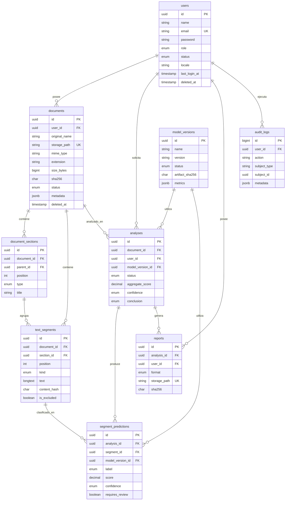

# Base de datos

## Motor

- **Producción y Docker:** PostgreSQL 18.6 (`postgres:18.6-alpine`).
- **Pruebas automatizadas:** SQLite en memoria (`phpunit.xml`).
- Las migraciones y la suite completa se ejecutaron con SQLite y con **PostgreSQL 18.6 nativo** (binarios oficiales para Windows). PostgreSQL acepta las 11 migraciones y las 64 pruebas. La ejecución dentro de contenedores Docker sigue pendiente porque Docker no está instalado en este equipo.

## Diagrama entidad-relación



## Tablas

### `users`

Cuentas de la plataforma.

- `id`: UUID.
- `email`: único, normalizado a minúsculas en la aplicación.
- `role`: `admin`, `user`.
- `status`: `active`, `suspended`.
- `locale`: por defecto `es`.
- `last_login_at`: se actualiza al iniciar sesión.
- `deleted_at`: borrado lógico.

### `documents`

Metadatos de cada archivo. El binario no se guarda en PostgreSQL.

- `storage_disk` / `storage_path`: ubicación en el disco privado.
- `sha256`: huella del contenido para integridad y deduplicación futura.
- `status`: `uploaded`, `validating`, `processing`, `ready`, `failed`, `deleted`.
- `metadata`: información adicional en `jsonb`.
- `deleted_at`: borrado lógico; la purga física se implementará en la Fase 6.

En la Fase 2, `metadata` guarda:

- `source`: `web`.
- `consent` / `consent_at`: declaración de autorización registrada en la carga.
- `extraction`: motor, `ocr_used`, `ocr_pages`, avisos, conteos y fecha de extracción.

### `document_sections`

Estructura lógica del documento (título, resumen, métodos, etc.).

- `parent_id`: permite jerarquía de secciones.
- `type`: `title`, `heading`, `abstract`, `introduction`, `methods`, `results`, `discussion`, `conclusion`, `references`, `appendix`, `other`.
- `position`: orden dentro del documento; único por documento.
- `level`, `title`, `char_start`, `char_end`: nivel jerárquico y offsets sobre el texto extraído.

### `text_segments`

Fragmentos extraídos y segmentados.

- `kind`: `paragraph`, `heading`, `caption`, `table`, `reference`, `list_item`, `other`.
- `text`: contenido extraído.
- `content_hash`: SHA-256 del texto para trazabilidad.
- `word_count`, `char_start`, `char_end`: métricas y offsets sobre el texto concatenado.
- `page_start` / `page_end`: páginas del PDF cuando aplica; `null` en DOCX.
- `is_excluded` / `exclusion_reason`: permite excluir referencias, tablas u otro contenido del análisis.
- `position`: único por documento.

### `analyses`

Ejecuciones de análisis.

- `status`: `queued`, `running`, `completed`, `failed`, `cancelled`.
- `aggregate_score`: puntuación agregada **opcional**; no implica probabilidad de autoría.
- `confidence`: `insufficient`, `low`, `medium`, `high`.
- `conclusion`: `not_conclusive`, `no_signals`, `review_suggested`, `mixed_signals`.
- `engine_version`: versión del código del motor.
- `model_version_id`: modelo utilizado, si existe.
- `document_sha256`: fija el contenido analizado aunque el documento cambie.

### `segment_predictions`

Resultado por fragmento.

- `label`: `human`, `ai`, `mixed`, `uncertain`.
- `score`: valor del modelo, sin presentarlo como probabilidad de autoría.
- `confidence`: `insufficient`, `low`, `medium`, `high`.
- `indicators` / `explanation`: señales explicativas.
- `requires_review`: marca fragmentos que requieren revisión humana.
- Restricción única `(analysis_id, segment_id)`.

### `reports`

Informes generados.

- `format`: `pdf`.
- `storage_path`: único, en disco privado.
- `sha256`: integridad del archivo.
- `expires_at`: reservado para retención.

### `model_versions`

Versionado y trazabilidad de modelos.

- `status`: `draft`, `candidate`, `active`, `retired`.
- `artifact_path` / `artifact_sha256`: ubicación e integridad del artefacto.
- `metrics`: métricas reales de evaluación, nunca inventadas.
- Restricción única `(name, version)`.

### `audit_logs`

Registro de acciones sensibles.

- `action`: por ejemplo `auth.login`, `auth.login_failed`, `admin.user.status_changed`.
- `subject_type` / `subject_id`: relación polimórfica opcional.
- `metadata`: contexto adicional en `jsonb`.
- `created_at`: sin `updated_at`; el registro es de solo adición desde la aplicación.

## Índices principales

- `users(email)` único; índices por `role` y `status`.
- `documents(user_id, created_at)`, `documents(status)`, `documents(sha256)`.
- `document_sections(document_id, position)` único; `(document_id, type)`.
- `text_segments(document_id, position)` único; `(document_id, is_excluded)`.
- `analyses(document_id, created_at)`, `(user_id, status)`.
- `segment_predictions(analysis_id, segment_id)` único; `(analysis_id, requires_review)`.
- `reports(analysis_id, created_at)`.
- `audit_logs(user_id, created_at)`, `(action, created_at)`, `(created_at)`.

## Migraciones

```powershell
# Aplicar cambios
docker compose exec app php artisan migrate --force

# Recrear la base con datos de ejemplo (solo desarrollo; destruye datos)
docker compose exec app php artisan migrate:fresh --seed --force
```

Migraciones incluidas:

1. `users`, `password_reset_tokens`, `sessions`
2. `cache`
3. `jobs`
4. `model_versions`
5. `documents`
6. `document_sections`
7. `text_segments`
8. `analyses`
9. `segment_predictions`
10. `reports`
11. `audit_logs`

Verificación en PostgreSQL 18.6 (binarios nativos, sin Docker): `migrate:fresh --force` aplica las 11 migraciones y la suite completa de Laravel pasa (64 pruebas, 221 aserciones). La primera ejecución detectó que la FK autorreferente de `document_sections.parent_id` se creaba antes que la clave primaria; la migración ahora añade esa FK después del `CREATE TABLE`.

## Privacidad y retención

- `SCITRACE_DOCUMENT_RETENTION_DAYS` define la retención prevista (365 días por defecto).
- La purga automática **no está implementada** (prevista para la Fase 6).
- El borrado lógico no elimina el archivo físico; la Fase 6 debe coordinar borrado lógico, borrado físico y auditoría.
- Los documentos no se usarán para entrenamiento sin autorización explícita y registrada.
