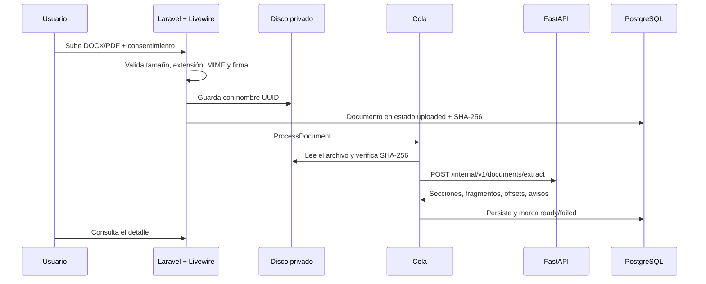

# Fase 2 — Carga privada, extracción y segmentación

**Estado:** **cerrada el 2026-10-23.** Verificación funcional completa en local: SQLite y PostgreSQL 18.6 nativo, OCR real con Tesseract 5.4.0 y `spa`, suites automatizadas y flujo E2E en navegador. Queda una única deuda de entorno: construir y ejecutar los contenedores Docker, porque Docker no está instalado en este equipo. Esa deuda afecta al despliegue, no a la lógica ya verificada. Ver [Criterios de aceptación](#criterios-de-aceptación).

## 1. Objetivo

Permitir que un usuario autenticado cargue un documento académico **DOCX o PDF**, lo almacene de forma privada y obtenga una extracción estructurada (secciones y fragmentos) lista para las fases de análisis.

La Fase 2 **no clasifica** el texto ni emite juicios de autoría. El motor sigue declarando `detector_ready=false`.

## 2. Prerrequisitos

- Fase 1 verificada (autenticación, roles, auditoría, comunicación Laravel ↔ FastAPI).
- Docker Desktop con WSL2 para la ruta recomendada, o el entorno local descrito en el README.
- Python 3.12, PHP 8.4, Node 24 y npm 11 si se ejecuta sin Docker.
- Tesseract con los paquetes de idioma `spa` y `eng` **solo** si se quiere probar OCR real. En esta verificación se usó Tesseract 5.4.0 con `eng`, `osd` y `spa` (este último desde `tessdata_fast`).

## 3. Alcance

### Incluido

- Carga privada con validación de tamaño, extensión, MIME y firma real del archivo.
- Consentimiento explícito antes de procesar.
- Almacenamiento en disco privado con nombre generado y SHA-256.
- Extracción de DOCX con `python-docx`.
- Extracción de PDF con PyMuPDF.
- OCR con Tesseract para páginas escaneadas (cuando el binario está disponible).
- Segmentación por encabezados académicos y párrafos.
- Exclusión de tablas y referencias del análisis posterior.
- Persistencia de secciones, fragmentos, offsets de caracteres y hashes.
- Listado, detalle, descarga y eliminación con acceso exclusivo del propietario.
- Reprocesamiento manual.
- Auditoría de carga, procesamiento, reprocesamiento y eliminación.

### No incluido

- Detección de IA, probabilidades o porcentajes.
- Informes PDF.
- Purga automática por retención.
- Antimalware.
- Entrenamiento con documentos de usuarios.
- Acceso de administradores al contenido documental.

## 4. Arquitectura y flujo



Decisiones clave:

- Laravel es el único responsable del almacenamiento, los permisos y la auditoría.
- FastAPI procesa el archivo **en memoria** y no lo persiste.
- El documento se envía a FastAPI como `multipart/form-data` con `X-Internal-Token`.
- La extracción se ejecuta en un job para no bloquear la petición web.
- El job vuelve a calcular el SHA-256 antes de llamar al motor; si no coincide, falla sin procesar.
- Los errores del motor se traducen a estados `failed` con un código estable.

## 5. Estructura de archivos

```text
ai-service/
├── app/
│   ├── api/v1/endpoints/documents.py   # Endpoint multipart de extracción
│   ├── schemas/extraction.py           # Contratos de respuesta
│   ├── services/extraction.py          # DOCX/PDF, OCR, secciones, segmentos
│   └── core/config.py                  # Límites y opciones de OCR
├── tests/
│   ├── document_samples.py             # DOCX, PDF de texto y PDF escaneado
│   ├── test_extraction.py              # Unidad de extracción
│   └── test_documents_api.py           # Contrato HTTP
└── Dockerfile                          # Tesseract + spa/eng

src/
├── app/
│   ├── Http/Controllers/DocumentController.php
│   ├── Http/Controllers/DocumentDownloadController.php
│   ├── Jobs/ProcessDocument.php
│   ├── Livewire/Documents/UploadDocument.php
│   ├── Livewire/Documents/DocumentList.php
│   ├── Livewire/Documents/DocumentDetail.php
│   ├── Policies/DocumentPolicy.php
│   └── Services/Ai/AiServiceClient.php
├── database/factories/DocumentFactory.php
├── resources/views/documents/{index,upload,show}.blade.php
├── resources/views/livewire/documents/*.blade.php
├── config/{scitrace,livewire,services}.php
└── tests/Feature/{DocumentUpload,ProcessDocument,DocumentAccess}Test.php
```

## 6. Persistencia

Se reutiliza el esquema creado en la Fase 1:

- `documents`: propietario, nombre original, disco, ruta, MIME, extensión, tamaño, SHA-256, estado, métricas y metadatos.
- `document_sections`: posición, nivel, tipo académico, título y offsets.
- `text_segments`: sección, posición, tipo, texto, hash, offsets, páginas, exclusión y motivo.

Los estados usados son `uploaded`, `validating`, `processing`, `ready` y `failed`.

El campo `metadata.extraction` guarda el motor, si se usó OCR, las páginas procesadas por OCR, los avisos y los conteos. El consentimiento se registra en `metadata.consent` y `metadata.consent_at`.

## 7. API interna de extracción

### `POST /internal/v1/documents/extract`

Requiere `X-Internal-Token`. Cuerpo `multipart/form-data` con el campo `file`.

Límites:

- Extensiones: `.docx`, `.pdf`.
- Tamaño máximo: `AI_MAX_DOCUMENT_BYTES` (25 MB por defecto).
- Máximo de fragmentos: `AI_MAX_SEGMENTS` (10 000 por defecto).

Respuesta `200` (resumida):

```json
{
  "original_name": "tesis.docx",
  "extension": "docx",
  "mime_type": "application/vnd.openxmlformats-officedocument.wordprocessingml.document",
  "size_bytes": 37040,
  "sha256": "e8ddf14c…",
  "engine": "python-docx",
  "ocr_used": false,
  "ocr_pages": [],
  "language": null,
  "warnings": [],
  "stats": {
    "page_count": null,
    "word_count": 65,
    "paragraph_count": 2,
    "section_count": 4,
    "segment_count": 8,
    "excluded_segment_count": 3
  },
  "sections": [
    {
      "position": 0,
      "type": "title",
      "title": "Impacto de la inteligencia artificial en la educación superior",
      "level": 1,
      "char_start": 0,
      "char_end": 62
    }
  ],
  "segments": [
    {
      "position": 0,
      "section_position": 0,
      "kind": "heading",
      "text": "Impacto de la inteligencia artificial en la educación superior",
      "content_hash": "…",
      "word_count": 9,
      "char_start": 0,
      "char_end": 62,
      "page_start": null,
      "page_end": null,
      "is_excluded": false,
      "exclusion_reason": null
    }
  ]
}
```

Errores:

| HTTP | `error.code` | Situación |
| --- | --- | --- |
| 401 | `http_error` | Token ausente o inválido |
| 413 | `document_too_large` | Archivo o número de fragmentos por encima del límite |
| 415 | `unsupported_type` | Extensión o MIME no admitido |
| 422 | `empty_document` | Archivo vacío o sin texto extraíble |
| 422 | `invalid_document` | DOCX/PDF corrupto |
| 422 | `ocr_unavailable` | PDF escaneado sin Tesseract disponible |

El detalle completo está en [api-v1.md](api-v1.md).

## 8. Reglas de extracción y segmentación

### DOCX

- Se recorren los párrafos y tablas en el orden del cuerpo del documento.
- Los encabezados se detectan por estilo (`Heading N`, `Title`) y por numeración académica (`1. Introducción`, `2.1 Métodos`).
- Los títulos se clasifican en `title`, `abstract`, `introduction`, `methods`, `results`, `discussion`, `conclusion`, `references`, `appendix` u `other`.
- Las tablas se guardan como fragmentos `table` y se marcan `is_excluded=true` con motivo `table`.
- Al entrar en una sección de referencias, los fragmentos pasan a `reference` y se excluyen con motivo `references`.

### PDF

- Se extrae el texto por página con PyMuPDF.
- Si una página tiene menos caracteres que `AI_MIN_TEXT_CHARS_PER_PAGE` y el OCR está habilitado, se rasteriza a `AI_OCR_DPI` y se aplica Tesseract con `AI_OCR_LANGUAGES`.
- Se registran las páginas procesadas por OCR en `ocr_pages` y se emite un aviso si una página no produce texto.

### Segmentos

- Cada fragmento conserva `char_start` y `char_end` sobre el texto concatenado.
- El hash se calcula con SHA-256 del texto normalizado.
- Se rechaza el documento si supera `AI_MAX_SEGMENTS`.
- Los fragmentos excluidos se guardan, pero las fases de análisis no deben usarlos.

## 9. Código

El código completo está en el repositorio; esta sección resume las piezas críticas.

- `ai-service/app/services/extraction.py`: extracción, OCR, detección de secciones, exclusión y hashes.
- `ai-service/app/api/v1/endpoints/documents.py`: validación de extensión/MIME/tamaño y contrato HTTP.
- `src/app/Services/Ai/AiServiceClient.php`: envío multipart y traducción de errores.
- `src/app/Jobs/ProcessDocument.php`: verificación de integridad, persistencia transaccional y estados de fallo.
- `src/app/Livewire/Documents/UploadDocument.php`: validación, consentimiento, firma real, almacenamiento y encolado.
- `src/app/Policies/DocumentPolicy.php`: acceso exclusivo del propietario.

Puntos que no deben alterarse sin revisar las pruebas:

1. El MIME declarado por el navegador no es confiable; se comprueba la firma real (`%PDF-` o `PK\x03\x04`).
2. El job nunca procesa un archivo cuyo SHA-256 no coincida con el registrado.
3. La persistencia es transaccional: si falla, no quedan secciones o fragmentos parciales.
4. El propietario es el único autorizado; los administradores no ven contenido documental.

## 10. Instalación y ejecución

### Con Docker

```powershell
powershell -ExecutionPolicy Bypass -File scripts/bootstrap.ps1
```

El `Dockerfile` del motor instala `tesseract-ocr`, `tesseract-ocr-spa` y `tesseract-ocr-eng`. La primera construcción tarda más por apt y por las dependencias de Python.

### Local (sin Docker)

```powershell
# Motor
cd ai-service
python -m venv .venv
.venv\Scripts\Activate.ps1
pip install -r requirements-dev.txt
$env:AI_INTERNAL_TOKEN = "un-token-de-al-menos-32-caracteres-para-desarrollo"
uvicorn app.main:create_app --factory --host 127.0.0.1 --port 8001

# Aplicación
cd ..\src
php artisan migrate
php artisan serve --host=127.0.0.1 --port=8099
```

Para procesar de inmediato en local, define `QUEUE_CONNECTION=sync`; en Docker se usa el worker.

Para OCR local en Windows, instala Tesseract y asegúrate de que el proceso lo encuentra:

```powershell
winget install --id UB-Mannheim.TesseractOCR --exact
$env:Path = "C:\Program Files\Tesseract-OCR;$env:Path"
# spa.traineddata no viene en el instalador; descárgalo de tessdata_fast
$env:TESSDATA_PREFIX = "$env:TEMP\scitrace-tessdata"
```

En la verificación de cierre, `spa.traineddata` se guardó en `%TEMP%\scitrace-tessdata` junto a `eng` y `osd`, porque `C:\Program Files` requiere elevación. La imagen Docker no necesita este ajuste: instala los paquetes del sistema.

## 11. Variables de entorno

| Variable | Por defecto | Uso |
| --- | --- | --- |
| `AI_SERVICE_URL` | `http://ai:8000` | URL interna del motor |
| `AI_INTERNAL_TOKEN` | vacío | Secreto compartido (mínimo 32 caracteres) |
| `AI_TIMEOUT_SECONDS` | `5` | Tiempo máximo de salud/capacidades |
| `AI_CONNECT_TIMEOUT_SECONDS` | `2` | Tiempo de conexión |
| `AI_EXTRACTION_TIMEOUT_SECONDS` | `120` | Tiempo máximo de extracción |
| `AI_MAX_DOCUMENT_BYTES` | `26214400` | Tamaño máximo en el motor |
| `AI_MAX_SEGMENTS` | `10000` | Fragmentos máximos |
| `AI_OCR_ENABLED` | `true` | Activa el OCR |
| `AI_OCR_LANGUAGES` | `spa+eng` | Idiomas de Tesseract |
| `AI_OCR_DPI` | `200` | Resolución de rasterizado |
| `AI_MIN_TEXT_CHARS_PER_PAGE` | `20` | Umbral para intentar OCR |
| `SCITRACE_DOCUMENTS_DISK` | `local` | Disco privado |
| `SCITRACE_MAX_UPLOAD_KB` | `25600` | Límite de carga en Laravel |
| `SCITRACE_MAX_SEGMENTS` | `10000` | Límite al persistir |
| `SCITRACE_MAX_SEGMENT_CHARS` | `200000` | Longitud máxima por fragmento |
| `LIVEWIRE_MAX_UPLOAD_KB` | `25600` | Límite de la carga temporal |

No se incluyen credenciales reales en el repositorio.

## 12. Verificación ejecutada

### Automatizada

```powershell
# Laravel
cd src
php artisan test --compact
php vendor/bin/pint --test

# Motor
cd ..\ai-service
python -m ruff check .
python -m pytest -q
```

Resultados observados el 2026-10-23:

| Suite | Resultado |
| --- | --- |
| Laravel (Pest) sobre SQLite | **64 pruebas, 221 aserciones, todas pasan** |
| Laravel (Pest) sobre PostgreSQL 18.6 | **64 pruebas, 221 aserciones, todas pasan** |
| Pint | Limpio |
| FastAPI (pytest) con Tesseract disponible | **30 pasan, 0 omitidas** |
| FastAPI (pytest) sin Tesseract | **29 pasan, 1 omitida** (la prueba real de OCR se omite) |
| ruff | Limpio |

### PostgreSQL 18.6 nativo

La verificación se hizo con los binarios oficiales de PostgreSQL 18.6 para Windows, sin Docker:

- `initdb` con autenticación local `trust` y una base dedicada.
- `php artisan migrate:fresh --force` con `pdo_pgsql`: **11 migraciones correctas**.
- Suite completa de Laravel con `RefreshDatabase`: **64 pruebas, 221 aserciones**.
- Job real `ProcessDocument` contra FastAPI: documento `ready`, 4 secciones, 8 fragmentos, 3 excluidos, 65 palabras y 2 párrafos.

La primera ejecución encontró un fallo que SQLite ocultaba: la autorreferencia `document_sections.parent_id → id` se creaba antes de que Laravel añadiera la clave primaria, y PostgreSQL la rechazaba con `SQLSTATE[42830]`. La migración se corrigió creando la FK en una sentencia posterior al `CREATE TABLE`. La corrección está verificada en PostgreSQL y la suite de SQLite sigue pasando.

### OCR real

- Tesseract **5.4.0.20240606** (UB Mannheim) en Windows.
- Idiomas `eng`, `osd` y `spa` (este último desde `tessdata_fast`, porque el instalador no lo incluye y el directorio `Program Files` requiere elevación).
- Prueba automatizada `test_scanned_pdf_uses_ocr_when_available`: pasa (ya no se omite).
- Prueba manual con un PDF escaneado sintético en español, sin capa de texto: `ocr_used=true`, `ocr_pages=[1]`, 36 palabras reconocidas y texto legible.

No se ha probado con escaneos reales de baja calidad, inclinados o con ruido; esa validación queda para la Fase 6 o para una batería de documentos representativos.

### Humo con servicios reales

- FastAPI en `127.0.0.1:8011` con un DOCX real:
  - `200`, `engine=python-docx`, 4 secciones, 8 fragmentos, 3 excluidos, 65 palabras, offsets presentes.
  - Sin token: `401`.
  - `.txt`: `415 unsupported_type`.
- Cliente Laravel contra FastAPI real: `engine=python-docx`, 8 fragmentos, 3 excluidos.
- Job completo con SQLite y FastAPI real: `ready`, 4 secciones, 8 fragmentos, 3 excluidos, 65 palabras, 2 párrafos.
- Job completo con PostgreSQL 18.6 y FastAPI real: mismos resultados, `status=ready`.

### Navegador (E2E)

Flujo ejecutado con un usuario de prueba y el DOCX de muestra:

1. Inicio de sesión.
2. Envío del formulario sin archivo ni consentimiento → dos errores de validación, sin documento creado.
3. Carga del DOCX con consentimiento → redirección al detalle.
4. Detalle: estado **Listo**, 65 palabras, 2 párrafos, 8 fragmentos, 3 excluidos, 4 secciones, motor `python-docx`.
5. Listado: solo aparecen los documentos del usuario autenticado.

Hash del archivo de muestra: `e8ddf14c5906da7dfe97f7d46722b4c321b2ab03b01a8edaaee85e242ecd1dfa`.

Captura: `docs/assets/phase-2-document-detail.png`.

## 13. Errores comunes

| Síntoma | Causa probable | Solución |
| --- | --- | --- |
| El documento queda en `uploaded` | No hay worker ni `QUEUE_CONNECTION=sync` | Ejecuta `php artisan queue:work` o usa `sync` en local |
| `ai_connection_failed` | `AI_SERVICE_URL` incorrecta o motor detenido | Revisa la URL y `docker compose ps` |
| `ai_auth_failed` | Token distinto entre Laravel y FastAPI | Usa el mismo `AI_INTERNAL_TOKEN` y reinicia ambos |
| `ocr_unavailable` | Tesseract no instalado en el host | Usa la imagen Docker o instala Tesseract con `spa` y `eng` |
| `document_too_large` | Supera 25 MB o 10 000 fragmentos | Divide el documento o ajusta los límites de forma consciente |
| `invalid_document` | Archivo corrupto o extensión falseada | Verifica el archivo original |
| `SQLSTATE[42830]` al migrar `document_sections` | FK autorreferente creada antes de la PK en PostgreSQL | Ya corregido: la FK se añade después del `CREATE TABLE` |
| Error 413 en Nginx | `client_max_body_size` menor que el límite | Ajusta Nginx y `upload_max_filesize`/`post_max_size` |
| La carga temporal falla | Límite de Livewire o disco | Revisa `config/livewire.php` y permisos de `storage` |

## 14. Criterios de aceptación

| Criterio | Estado |
| --- | --- |
| Rechaza extensiones no admitidas y archivos con firma falsa | Verificado con pruebas automatizadas; el navegador verificó la validación del formulario |
| Exige consentimiento explícito | Verificado con pruebas y navegador |
| Guarda en disco privado con nombre generado y SHA-256 | Verificado con SQLite y PostgreSQL 18.6 |
| Extrae DOCX con secciones y párrafos | Verificado con pruebas y servicio real |
| Extrae PDF con texto y páginas | Verificado con pruebas |
| Excluye tablas y referencias | Verificado con pruebas y servicio real |
| Persiste offsets y hashes | Verificado con pruebas |
| Marca fallos sin datos parciales | Verificado con pruebas |
| Acceso exclusivo del propietario | Verificado con pruebas |
| Descarga autorizada con `nosniff` | Verificado con pruebas |
| Reprocesamiento y eliminación | Verificado con pruebas |
| OCR real con Tesseract | **Verificado**: Tesseract 5.4.0 + `spa+eng`, PDF escaneado en español |
| Migraciones en PostgreSQL 18.6 | **Verificado**: `migrate:fresh` y suite completa (64/221) |
| Contenedores, healthchecks y OCR en Docker | **Pendiente de entorno**: Docker no está instalado. No bloquea la lógica; sí el despliegue |
| Antimalware y purga por retención | Fuera del alcance de la Fase 2 |

## 15. Limitaciones conocidas

- La extracción de PDF escaneado depende de Tesseract; sin él, el documento falla con `ocr_unavailable` en lugar de devolver texto inventado.
- La detección de encabezados es heurística: documentos con formato atípico pueden quedar en `other`.
- No se garantiza una reconstrucción perfecta del orden de lectura en PDF con columnas o tablas complejas.
- El OCR puede introducir errores; por eso se registra `ocr_used` y las páginas afectadas. La verificación usó un PDF sintético legible; no se han probado escaneos reales con ruido, inclinación o baja resolución.
- No se ha validado el rendimiento con documentos de 25 MB ni con cientos de páginas.
- La imagen Docker del motor no se ha construido en este equipo; la ruta Docker sigue sin verificación de extremo a extremo.
- El resultado de esta fase **no es un diagnóstico de autoría**.

## 16. Cierre de la fase y transición

La Fase 2 se considera **cerrada funcionalmente** con estas condiciones:

1. Todas las pruebas automatizadas pasan en SQLite y PostgreSQL 18.6.
2. El OCR real funciona con Tesseract 5.4.0 y español.
3. El flujo completo se verificó en navegador y con el job real.
4. La única deuda es de entorno: construir y ejecutar los contenedores Docker.

Antes de desplegar en un servidor, debe completarse la verificación Docker:

```powershell
powershell -ExecutionPolicy Bypass -File scripts/bootstrap.ps1
powershell -ExecutionPolicy Bypass -File scripts/verify.ps1
```

La Fase 3 (detector calibrado) puede comenzar sobre esta base, pero no debe presentarse ningún resultado como validado hasta que exista un modelo entrenado, calibrado y evaluado con documentos representativos. El detector seguirá devolviendo `not_conclusive` cuando no haya evidencia suficiente.
